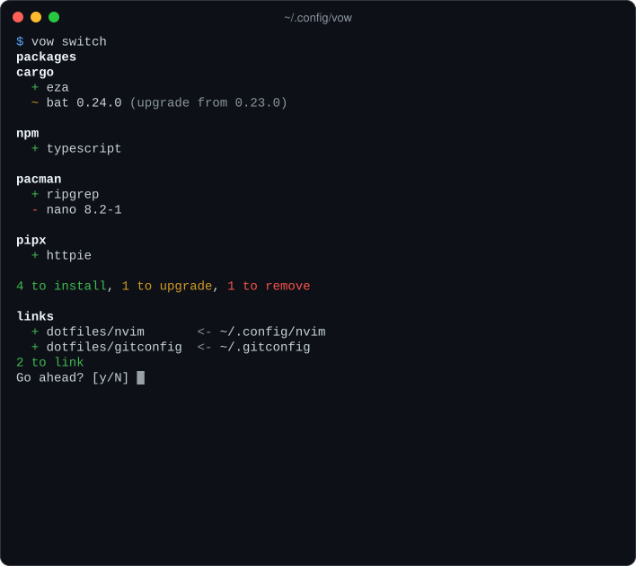
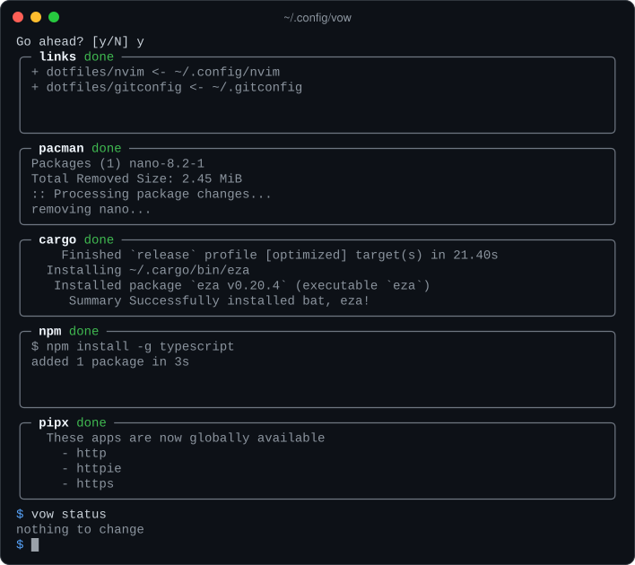

<h1 align="center">vow</h1>

<p align="center">
  <strong>Declare the packages and dotfiles your machines should have. Repeatability on any system</strong>
</p>

<p align="center">
  <a href="https://github.com/Houdiee/vow/actions/workflows/ci.yml"></a>
  <a href="https://github.com/Houdiee/vow/actions/workflows/managers.yml"></a>
  <a href="LICENSE"></a>
  
</p>

<p align="center">
  <a href="#why-vow">Why</a> •
  <a href="#features">Features</a> •
  <a href="#installation">Install</a> •
  <a href="#quick-start">Quick start</a> •
  <a href="docs/GUIDE.md">Guide</a>
</p>

<p align="center">
  
  
</p>

## Why vow?

Every machine drifts. A tool goes in with `cargo`, another with `pacman`, an
editor plugin with `npm`, and a dotfile gets tweaked in `~/.config`. Six months
later nobody can say what the setup actually is, let alone rebuild it on a new
laptop.

The usual fixes each cover part of the problem:

- **Nix** solves it completely, by replacing your package managers and your
  distro's way of doing things.
- **stow** and **chezmoi** keep dotfiles, but not the packages those dotfiles
  configure.
- **Ansible** can do both, but as a playbook of steps. Removing a line doesn't
  remove the package.

vow sits in between. You keep using the package managers you already have,
whether that's 1 or 20 of them. vow keeps a list for each one, plus your
dotfiles, in a folder you track in git. It makes the machine match in both
directions: what's declared gets installed, and what's no longer declared gets
removed.

## Features

- 📝 **Plain TOML, no DSL.** A list per manager and a table of links. A
  package is `name`, or `name version` to hold it at an exact version.
- 🧰 **43 package managers.** System (`apt`, `pacman`, `brew`, `dnf`),
  language (`cargo`, `npm`, `pip`, `go`), version managers (`rustup`, `mise`,
  `pyenv`), editor extensions and more, each driven through its own CLI.
- 🔄 **Converges both ways.** It installs what's declared and removes what
  isn't. A manager with no list is left alone, and `npm = []` keeps npm at
  nothing installed.
- 🔗 **Dotfiles as symlinks.** Files stay in the graph, so editing
  `~/.config/nvim/init.lua` edits the copy in git. vow only ever replaces
  symlinks it placed itself.
- 🧩 **One file per machine, shared through includes.** A machine applies
  `hosts/<hostname>.toml`, or `config.toml` if it has none, plus whatever that
  file includes. Files merge, and a disagreement between two files is an
  error, never a silent override.
- ⚡ **Staged and parallel.** System managers run first, then version
  managers, then everything else. So `apt` can install `cargo` and the
  `cargo` list is applied in the same switch. Within a stage, managers run
  side by side, each in a live box.
- 🎯 **Compiler-style errors.** Mistakes are reported at their file, line and
  column, with a note on how to fix them.
- 🛡️ **Careful by default.** It shows the plan before changing anything,
  checks afterwards that every change took effect, and writes every file
  atomically. A removal never takes a package that something else still
  needs.

## Installation

Build from this repository with Cargo (Rust 1.88 or newer):

```sh
cargo install --locked --git https://github.com/Houdiee/vow
```

Or from a clone:

```sh
git clone https://github.com/Houdiee/vow && cd vow
cargo build --release
install -Dm755 target/release/vow ~/.local/bin/vow
```

With Nix, `nix develop` in the clone gives you a shell with the Rust
toolchain, and `cargo build --release` works from there.

vow is developed and tested on Linux. It works with whichever of its
[supported managers](#supported-managers) are on your `PATH`.

## Quick start

**1. Declare this machine as it is.** `generate-config` writes
`~/.config/vow/config.toml`, listing what every installed manager has
installed:

```sh
vow generate-config
vow status                     # nothing to change
```

**2. Bring in a dotfile.** Move it into the graph:

```sh
mv ~/.config/nvim ~/.config/vow/nvim
```

Then declare where it goes, in the `[links]` table at the end of
`config.toml`, and switch:

```toml
[links]
nvim = { source = "nvim", target = "~/.config/nvim" }
```

```sh
vow switch                     # shows "+ nvim <- ~/.config/nvim", asks, links
```

**3. Track it in git.**

```sh
cd ~/.config/vow && git init && git add -A && git commit -m "my machine"
```

**On another machine,** clone the graph and converge:

```sh
git clone <your-repo> ~/.config/vow
vow status                     # what this machine is missing, or has extra
vow switch                     # install, remove and link to match
```

## Configuration

When machines start to differ, give each its own host file, found by
hostname. It includes what the machines share:

```text
~/.config/vow/
├── config.toml           # applied by a machine with no host file
├── hosts/
│   ├── laptop.toml       # applied by the machine named "laptop"
│   └── desktop.toml
├── common.toml           # anything a host file includes, named as you like
└── dotfiles/             # your files, laid out however you like
```

```toml
# common.toml
[packages]
pacman = ["git", "neovim", "ripgrep"]
cargo = ["bat", "eza 0.20.0"]   # a version holds it there

[links]
nvim = { source = "dotfiles/nvim", target = "~/.config/nvim" }
git = { source = "dotfiles/gitconfig", target = "~/.gitconfig" }
```

```toml
# hosts/laptop.toml
includes = ["../common.toml"]

[packages]
pacman = ["tlp", "brightnessctl"]   # merged with common.toml's list
```

The same package declared alike in two files merges. Declared differently,
it's an error, reported where it happens. Add `cargo = ["bat 0.24.0"]` to the
laptop's file and:

```console
$ vow status
error: `bat` is already declared as `bat 0.24.0` in `hosts/laptop.toml`
 --> ~/.config/vow/common.toml:3:10
  |
3 | cargo = ["bat", "eza 0.20.0"]   # a version holds it there
  |          ^^^^^ declared differently here
  |
  = note: first declared at ~/.config/vow/hosts/laptop.toml:5; files merge only what they declare alike, and none overrides another: make them agree, or declare the package in one file
```

There's no overriding and no templating, by design. If something should apply
everywhere except one machine, put it in a file that machine doesn't include.
If a dotfile needs per-machine differences, use the tool's own include or
conditional (git's `includeIf`, ssh's `Match`, `source` in a shell). The
[guide](docs/GUIDE.md#the-graph) has the full rules.

## Commands

| Command | What it does |
|-|-|
| `vow status` | Show how this machine differs from what it declares |
| `vow switch` | Converge: show the plan, confirm, then link, install and remove |
| `vow switch --dry-run` | Show the plan and stop |
| `vow switch --upgrade` | Also bring unpinned packages up to date |
| `vow generate-config [--pin]` | Write a file declaring everything installed now |
| `vow outdated` | Declared packages with a newer version available |
| `vow search <query>` | Search each manager's own index |
| `vow links` | Every link this machine applies, which file declares it, and whether it's in place |
| `vow managed` | Every supported manager, and which ones this machine manages |

Name managers first to act on just those: `vow cargo,npm status`.
`--packages` and `--links` restrict a command to one half. `--host=NAME` or
`--file=PATH` applies another machine's file, and `--path` points at a graph
somewhere else.

## Supported managers

vow supports 43 package managers, applied in three stages:

| Stage | Managers |
|-|-|
| System | `apk` `apt` `brew` `dnf` `pacman` `xbps` `zypper` |
| Toolchains | `asdf` `bob` `elan` `ghcup` `mise` `pyenv` `rustup` `volta` `zvm` |
| Everything else | `bun` `cargo` `code` `code-server` `codium` `composer` `coursier` `dotnet` `fisher` `flatpak` `gem` `go` `krew` `luarocks` `npm` `ollama` `opam` `pip` `pipx` `pixi` `pnpm` `pub` `raco` `soar` `uv` `yarn` `yazi` |

Every manager except `flatpak`, `code` and `codium` is tested weekly against
the real tool in its own container: vow installs a package, reads it back,
searches, and removes it.

A manager is only added when its explicitly installed packages can be told
apart from their dependencies. Otherwise vow would offer to remove
dependencies. The [guide](docs/GUIDE.md#supported-managers) explains why some
obvious candidates are missing.

## Compared with

| | vow | Nix + home-manager | chezmoi | GNU stow | Ansible |
|-|:-:|:-:|:-:|:-:|:-:|
| Packages | ✅ | ✅ | via scripts | ❌ | ✅ |
| Dotfiles | ✅ symlinks | ✅ | ✅ copies | ✅ symlinks | ✅ |
| Removes what you undeclare | ✅ | ✅ | ❌ | ❌ | only if written as a task |
| Drives the package managers you already use | ✅ | ❌ | – | – | ✅ |
| Format | TOML | Nix language | files + Go templates | directory layout | YAML playbooks |
| Templating | ❌ by design | ✅ | ✅ | ❌ | ✅ |

If you want every machine to be bit-for-bit reproducible, use Nix. If you want
the tools you already have, with a machine you can describe in a few lists and
rebuild with one command, use vow.

## Documentation

- [**The guide**](docs/GUIDE.md) is the full reference: every rule, with
  examples.
  - [The graph](docs/GUIDE.md#the-graph): the file format, which file a
    machine applies, and includes.
  - [Packages](docs/GUIDE.md#packages) and [Versions](docs/GUIDE.md#versions):
    how lists merge, and which managers accept a version.
  - [Links](docs/GUIDE.md#links): how links are placed, replaced and removed.
  - [Safety](docs/GUIDE.md#safety): what vow will and won't do to a machine.
  - [How a switch runs](docs/GUIDE.md#how-a-switch-runs): stages, prompts and
    failures.
- `vow --help` and `vow <command> --help` cover every command and flag.

## Contributing

Bug reports and ideas are welcome in the
[issues](https://github.com/Houdiee/vow/issues). If vow misreads a manager's
output, please paste what the tool printed. New managers are only added from
real captured output.

Before opening a pull request, read [`AGENTS.md`](AGENTS.md). It covers the
code layout, the design decisions already made, and how to run the tests:

```sh
cargo fmt --check && cargo clippy --all-targets && cargo test
VOW_CONTAINERS=1 cargo test container::apt     # one manager, against the real tool (needs docker)
```

## License

[MIT](LICENSE) © Houdiee
